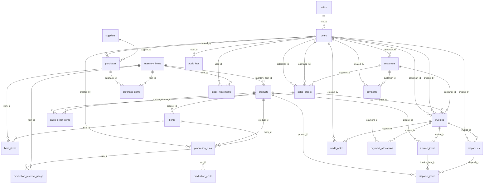

# Database schema

Generated from the SQLAlchemy metadata (`app/models.py`). Decimal columns are stored as exact decimal text (`DecimalString`).

## `inventory_items`

| Column | Type | Constraints |
|---|---|---|
| id | Integer | PK |
| sku | String | UNIQUE, NOT NULL |
| name | String | NOT NULL |
| item_type | String | NOT NULL, INDEX |
| category | String | NOT NULL |
| unit | String | NOT NULL |
| reorder_level | DecimalString | NOT NULL |
| valuation_method | String | NOT NULL |
| avg_cost | DecimalString | NOT NULL |
| is_active | Boolean | NOT NULL |
| created_at | DateTime | NOT NULL |
| updated_at | DateTime | NOT NULL |

## `invoice_sequences`

| Column | Type | Constraints |
|---|---|---|
| id | Integer | PK |
| prefix | String | NOT NULL |
| financial_year | String | NOT NULL |
| last_number | Integer | NOT NULL |

Unique together: (prefix, financial_year)

## `roles`

| Column | Type | Constraints |
|---|---|---|
| id | Integer | PK |
| name | String | UNIQUE, NOT NULL |
| description | String | NOT NULL |

## `suppliers`

| Column | Type | Constraints |
|---|---|---|
| id | Integer | PK |
| name | String | UNIQUE, NOT NULL |
| contact | String |  |
| gstin | String |  |
| address | String | NOT NULL |
| state | String | NOT NULL |
| payment_terms | String | NOT NULL |
| is_active | Boolean | NOT NULL |
| created_at | DateTime | NOT NULL |
| updated_at | DateTime | NOT NULL |

## `system_settings`

| Column | Type | Constraints |
|---|---|---|
| key | String | PK |
| value | String | NOT NULL |
| description | String | NOT NULL |

## `products`

| Column | Type | Constraints |
|---|---|---|
| id | Integer | PK |
| name | String | NOT NULL |
| category | String | NOT NULL |
| sku | String | UNIQUE, NOT NULL |
| pack_size | String | NOT NULL |
| unit | String | NOT NULL |
| hsn_code | String | NOT NULL |
| gst_rate | DecimalString | NOT NULL |
| selling_price | DecimalString | NOT NULL |
| reorder_level | DecimalString | NOT NULL |
| is_active | Boolean | NOT NULL |
| inventory_item_id | Integer | FK → inventory_items.id |
| created_at | DateTime | NOT NULL |
| updated_at | DateTime | NOT NULL |

## `users`

| Column | Type | Constraints |
|---|---|---|
| id | Integer | PK |
| username | String | UNIQUE, NOT NULL, INDEX |
| full_name | String | NOT NULL |
| email | String |  |
| password_hash | String | NOT NULL |
| role_id | Integer | FK → roles.id, NOT NULL |
| is_active | Boolean | NOT NULL |
| created_at | DateTime | NOT NULL |
| updated_at | DateTime | NOT NULL |

## `audit_logs`

| Column | Type | Constraints |
|---|---|---|
| id | Integer | PK |
| user_id | Integer | FK → users.id |
| username | String | NOT NULL |
| action | String | NOT NULL, INDEX |
| entity_type | String | NOT NULL, INDEX |
| entity_id | Integer |  |
| old_values | JSON |  |
| new_values | JSON |  |
| created_at | DateTime | NOT NULL, INDEX |

## `boms`

| Column | Type | Constraints |
|---|---|---|
| id | Integer | PK |
| product_id | Integer | FK → products.id, NOT NULL |
| version | Integer | NOT NULL |
| batch_size | DecimalString | NOT NULL |
| expected_output | DecimalString | NOT NULL |
| effective_date | Date | NOT NULL |
| is_active | Boolean | NOT NULL |
| notes | String | NOT NULL |
| created_at | DateTime | NOT NULL |
| updated_at | DateTime | NOT NULL |

Unique together: (product_id, version)

## `customers`

| Column | Type | Constraints |
|---|---|---|
| id | Integer | PK |
| name | String | NOT NULL, INDEX |
| customer_type | String | NOT NULL |
| gstin | String |  |
| billing_address | String | NOT NULL |
| shipping_address | String | NOT NULL |
| city | String | NOT NULL |
| state | String | NOT NULL |
| state_code | String | NOT NULL |
| phone | String |  |
| email | String |  |
| salesman_id | Integer | FK → users.id |
| credit_limit | DecimalString | NOT NULL |
| payment_terms_days | Integer | NOT NULL |
| is_active | Boolean | NOT NULL |
| created_at | DateTime | NOT NULL |
| updated_at | DateTime | NOT NULL |

## `purchases`

| Column | Type | Constraints |
|---|---|---|
| id | Integer | PK |
| po_number | String | UNIQUE, NOT NULL |
| supplier_id | Integer | FK → suppliers.id, NOT NULL |
| supplier_invoice_no | String | NOT NULL |
| purchase_date | Date | NOT NULL |
| status | String | NOT NULL |
| total | DecimalString | NOT NULL |
| idempotency_key | String | UNIQUE |
| created_by | Integer | FK → users.id |
| received_at | DateTime |  |
| created_at | DateTime | NOT NULL |
| updated_at | DateTime | NOT NULL |

Unique together: (supplier_id, supplier_invoice_no)

## `stock_movements`

| Column | Type | Constraints |
|---|---|---|
| id | Integer | PK |
| item_id | Integer | FK → inventory_items.id, NOT NULL, INDEX |
| quantity | DecimalString | NOT NULL |
| unit | String | NOT NULL |
| direction | String | NOT NULL |
| movement_type | String | NOT NULL, INDEX |
| txn_date | Date | NOT NULL, INDEX |
| source_type | String | NOT NULL |
| source_id | Integer |  |
| user_id | Integer | FK → users.id |
| created_at | DateTime | NOT NULL |
| remarks | String | NOT NULL |
| unit_cost | DecimalString | NOT NULL |
| value | DecimalString | NOT NULL |

## `bom_items`

| Column | Type | Constraints |
|---|---|---|
| id | Integer | PK |
| bom_id | Integer | FK → boms.id, NOT NULL |
| item_id | Integer | FK → inventory_items.id, NOT NULL |
| quantity | DecimalString | NOT NULL |
| unit | String | NOT NULL |
| is_primary_pack | Boolean | NOT NULL |

## `payments`

| Column | Type | Constraints |
|---|---|---|
| id | Integer | PK |
| receipt_no | String | UNIQUE, NOT NULL |
| customer_id | Integer | FK → customers.id, NOT NULL, INDEX |
| payment_date | Date | NOT NULL, INDEX |
| amount | DecimalString | NOT NULL |
| mode | String | NOT NULL |
| reference | String | NOT NULL |
| remarks | String | NOT NULL |
| idempotency_key | String | UNIQUE |
| created_by | Integer | FK → users.id |
| created_at | DateTime | NOT NULL |
| updated_at | DateTime | NOT NULL |

## `production_runs`

| Column | Type | Constraints |
|---|---|---|
| id | Integer | PK |
| run_number | String | UNIQUE, NOT NULL |
| product_id | Integer | FK → products.id, NOT NULL |
| bom_id | Integer | FK → boms.id, NOT NULL |
| run_date | Date | NOT NULL |
| batches | DecimalString | NOT NULL |
| status | String | NOT NULL |
| expected_output | DecimalString | NOT NULL |
| good_output | DecimalString | NOT NULL |
| damaged_packets | DecimalString | NOT NULL |
| damaged_pouches | DecimalString | NOT NULL |
| scrap_qty | DecimalString | NOT NULL |
| material_wastage | DecimalString | NOT NULL |
| yield_variance_pct | DecimalString | NOT NULL |
| tolerance_pct | DecimalString | NOT NULL |
| yield_alert | Boolean | NOT NULL |
| remarks | String | NOT NULL |
| idempotency_key | String | UNIQUE |
| created_by | Integer | FK → users.id |
| created_at | DateTime | NOT NULL |
| updated_at | DateTime | NOT NULL |

## `purchase_items`

| Column | Type | Constraints |
|---|---|---|
| id | Integer | PK |
| purchase_id | Integer | FK → purchases.id, NOT NULL |
| item_id | Integer | FK → inventory_items.id, NOT NULL |
| quantity | DecimalString | NOT NULL |
| unit | String | NOT NULL |
| rate | DecimalString | NOT NULL |
| amount | DecimalString | NOT NULL |

## `sales_orders`

| Column | Type | Constraints |
|---|---|---|
| id | Integer | PK |
| order_no | String | UNIQUE, NOT NULL |
| customer_id | Integer | FK → customers.id, NOT NULL, INDEX |
| salesman_id | Integer | FK → users.id, NOT NULL, INDEX |
| status | String | NOT NULL, INDEX |
| order_date | Date | NOT NULL |
| remarks | String | NOT NULL |
| change_reason | String | NOT NULL |
| rejection_reason | String | NOT NULL |
| subtotal | DecimalString | NOT NULL |
| tax_estimate | DecimalString | NOT NULL |
| total_estimate | DecimalString | NOT NULL |
| idempotency_key | String | UNIQUE |
| approved_by | Integer | FK → users.id |
| created_at | DateTime | NOT NULL |
| updated_at | DateTime | NOT NULL |

## `invoices`

| Column | Type | Constraints |
|---|---|---|
| id | Integer | PK |
| invoice_no | String | UNIQUE, NOT NULL |
| financial_year | String | NOT NULL |
| invoice_date | Date | NOT NULL, INDEX |
| due_date | Date | NOT NULL |
| order_id | Integer | FK → sales_orders.id |
| customer_id | Integer | FK → customers.id, NOT NULL, INDEX |
| salesman_id | Integer | FK → users.id |
| seller_name | String | NOT NULL |
| seller_gstin | String | NOT NULL |
| seller_address | String | NOT NULL |
| buyer_name | String | NOT NULL |
| buyer_gstin | String |  |
| buyer_address | String | NOT NULL |
| place_of_supply | String | NOT NULL |
| place_of_supply_code | String | NOT NULL |
| is_interstate | Boolean | NOT NULL |
| taxable_amount | DecimalString | NOT NULL |
| cgst | DecimalString | NOT NULL |
| sgst | DecimalString | NOT NULL |
| igst | DecimalString | NOT NULL |
| total | DecimalString | NOT NULL |
| status | String | NOT NULL |
| dispatch_status | String | NOT NULL |
| cancel_reason | String | NOT NULL |
| created_by | Integer | FK → users.id |
| created_at | DateTime | NOT NULL |
| updated_at | DateTime | NOT NULL |

## `production_costs`

| Column | Type | Constraints |
|---|---|---|
| id | Integer | PK |
| run_id | Integer | UNIQUE, FK → production_runs.id, NOT NULL |
| material_cost | DecimalString | NOT NULL |
| labour | DecimalString | NOT NULL |
| gas_power | DecimalString | NOT NULL |
| other_overhead | DecimalString | NOT NULL |
| overhead_total | DecimalString | NOT NULL |
| total_cost | DecimalString | NOT NULL |
| cost_per_packet | DecimalString | NOT NULL |
| selling_price | DecimalString | NOT NULL |
| gross_profit_per_packet | DecimalString | NOT NULL |
| gross_margin_pct | DecimalString | NOT NULL |
| created_at | DateTime | NOT NULL |
| updated_at | DateTime | NOT NULL |

## `production_material_usage`

| Column | Type | Constraints |
|---|---|---|
| id | Integer | PK |
| run_id | Integer | FK → production_runs.id, NOT NULL |
| item_id | Integer | FK → inventory_items.id, NOT NULL |
| standard_qty | DecimalString | NOT NULL |
| actual_qty | DecimalString | NOT NULL |
| unit | String | NOT NULL |
| unit_cost | DecimalString | NOT NULL |
| cost | DecimalString | NOT NULL |
| difference | DecimalString | NOT NULL |
| variance_pct | DecimalString | NOT NULL |
| alert | Boolean | NOT NULL |

## `sales_order_items`

| Column | Type | Constraints |
|---|---|---|
| id | Integer | PK |
| order_id | Integer | FK → sales_orders.id, NOT NULL |
| product_id | Integer | FK → products.id, NOT NULL |
| quantity | DecimalString | NOT NULL |
| unit_price | DecimalString | NOT NULL |

## `credit_notes`

| Column | Type | Constraints |
|---|---|---|
| id | Integer | PK |
| credit_note_no | String | UNIQUE, NOT NULL |
| invoice_id | Integer | FK → invoices.id, NOT NULL, INDEX |
| note_date | Date | NOT NULL |
| reason | String | NOT NULL |
| taxable_amount | DecimalString | NOT NULL |
| cgst | DecimalString | NOT NULL |
| sgst | DecimalString | NOT NULL |
| igst | DecimalString | NOT NULL |
| total | DecimalString | NOT NULL |
| restocked | Boolean | NOT NULL |
| created_by | Integer | FK → users.id |
| created_at | DateTime | NOT NULL |
| updated_at | DateTime | NOT NULL |

## `dispatches`

| Column | Type | Constraints |
|---|---|---|
| id | Integer | PK |
| dispatch_no | String | UNIQUE, NOT NULL |
| invoice_id | Integer | FK → invoices.id, NOT NULL, INDEX |
| dispatch_date | Date | NOT NULL |
| vehicle_no | String | NOT NULL |
| remarks | String | NOT NULL |
| idempotency_key | String | UNIQUE |
| created_by | Integer | FK → users.id |
| created_at | DateTime | NOT NULL |
| updated_at | DateTime | NOT NULL |

## `invoice_items`

| Column | Type | Constraints |
|---|---|---|
| id | Integer | PK |
| invoice_id | Integer | FK → invoices.id, NOT NULL |
| product_id | Integer | FK → products.id, NOT NULL |
| description | String | NOT NULL |
| hsn_code | String | NOT NULL |
| quantity | DecimalString | NOT NULL |
| unit | String | NOT NULL |
| unit_price | DecimalString | NOT NULL |
| taxable_amount | DecimalString | NOT NULL |
| gst_rate | DecimalString | NOT NULL |
| cgst | DecimalString | NOT NULL |
| sgst | DecimalString | NOT NULL |
| igst | DecimalString | NOT NULL |
| total | DecimalString | NOT NULL |
| dispatched_qty | DecimalString | NOT NULL |
| returned_qty | DecimalString | NOT NULL |
| restocked_qty | DecimalString | NOT NULL |

## `payment_allocations`

| Column | Type | Constraints |
|---|---|---|
| id | Integer | PK |
| payment_id | Integer | FK → payments.id, NOT NULL |
| invoice_id | Integer | FK → invoices.id, NOT NULL, INDEX |
| amount | DecimalString | NOT NULL |

## `dispatch_items`

| Column | Type | Constraints |
|---|---|---|
| id | Integer | PK |
| dispatch_id | Integer | FK → dispatches.id, NOT NULL |
| invoice_item_id | Integer | FK → invoice_items.id, NOT NULL |
| product_id | Integer | FK → products.id, NOT NULL |
| quantity | DecimalString | NOT NULL |

## ER diagram (Mermaid, all relationships)

