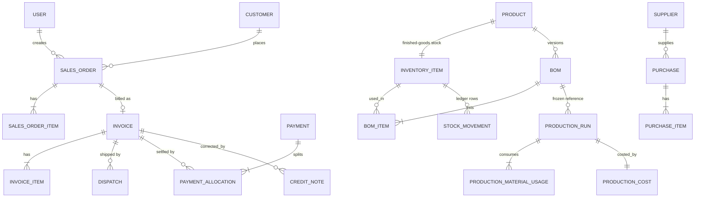

# FactoryFlow — Design Note

## 1. Architecture
React/TypeScript SPA (Vite, TanStack Query, Tailwind) → REST/JSON over `/api/v1` → FastAPI → **service layer** → SQLAlchemy 2 → SQLite (dev) / PostgreSQL (deploy).
Layers: `routers/` (HTTP + role dependencies only) · `schemas.py` (Pydantic v2) · `services/` (all business rules: stock, purchase, production, sales/GST/payments, reports, dashboard, pdf) · `models.py` · `core/` (config, security, units, errors, DecimalString type). Routers never compute business values. Authentication is JWT (HS256, 60 min) with bcrypt hashes; `require_roles(...)` enforces permissions server-side on every route; the frontend only hides links.
Every state-changing service owns its transaction: it does all validation and ledger writes, then `commit()` once; any exception propagates and the request session rolls everything back.

## 2. ER overview

Full 26-table diagram: `docs/database-schema.md`.

## 3. Stock ledger design
`stock_movements` is the single source of truth and is **append-only** (ORM listeners reject UPDATE/DELETE). Each row: item, positive quantity in the item's stock unit, direction IN/OUT, movement type (OPENING, PURCHASE_RECEIPT, PRODUCTION_ISSUE, PRODUCTION_OUTPUT, PACKAGING_CONSUMPTION, SALES_DISPATCH, SALES_RETURN, PURCHASE_RETURN, STOCK_ADJUSTMENT), txn date, source document type+id, user, timestamp, remarks, rate and value. **Balances are never stored**; `stock.balance()` sums the ledger, so the closing balance is always reconstructable. All writers go through `stock.post_movement()`, which converts units, rejects negative stock (`InsufficientStock` with available/requested/shortage) and updates the weighted-average rate. Corrections are explicit STOCK_ADJUSTMENT entries with a reason. Submitting/approving an order never touches stock; only a confirmed dispatch does.

## 4. BOM and production calculation
A BOM (product, version, expected output per batch, effective date) has items (standard qty per batch, unit). Runs reference a specific BOM version, so editing a recipe creates v2 and old runs are untouched.
* Expected output = BOM yield × batches.  Standard consumption = BOM qty × batches (converted to the item's unit).
* Yield variance % = (good − expected) / expected × 100.  Consumption variance % = (actual − standard) / standard × 100 (positive = excess use).
* Alert when |variance| > tolerance (system setting, default 3%).
* Primary pouch consumption = good packets + damaged packets + damaged pouches (benchmark: 188 + 0 + 6 = 194). Good output, damaged packets, damaged pouches, scrap and material wastage are stored as separate columns.
* Completion posts all issues, then the finished-goods receipt, then run/usage/cost rows, in one transaction. Any shortage rolls back everything (tested).

## 5. Unit conversion
`core/units.py` maps kg/g → mass (base g), litre/ml → volume (base ml), piece/packet → count, carton → its own dimension. `convert()` multiplies via base-unit factors using `Decimal`; incompatible dimensions (kg→litre, carton→piece) raise `UnitError`. Entered units are converted to the item's stock unit at the service boundary; purchase rates are per *entered* unit, so 10,000 g @ ₹0.045 equals 10 kg @ ₹45.

## 6. Costing and weighted average
On every IN movement with a cost: `new_avg = (old_qty × old_avg + in_value) / (old_qty + in_qty)`. Flour: 100 kg × 42 + 60 kg × 45 = ₹6,900 / 160 kg = **₹43.125/kg**. Consumption is valued at the current average (average is unchanged by issues) and stored on each usage row. Run cost = Σ(actual qty × avg rate) for raw **and actual packaging consumed** + overheads (labour + gas/power + other, entered after the run). Cost per good packet = total cost / good packets; gross profit = selling price − cost per packet. Benchmark: (4,055 + 1,800) / 188 = ₹31.1436. Finished goods are valued at material cost at completion (overheads are reported in the costing report, not back-posted to FG stock — a documented simplification).

## 7. Key business assumptions
Factory in Tamil Nadu (state code 33); intra-state → CGST+SGST (2.5% each), inter-state → IGST 5%; the GST treatment is a **simplified exercise assumption, not tax advice or a filing system**. Money is rounded half-up to paise per invoice line. Invoice numbers `FF/<FY>/<seq>`, FY = April–March. Posted invoices have no edit/delete API; corrections = credit note or cancellation (returns dispatched goods to stock; blocked if payments are allocated). Payments cannot exceed outstanding (no advance workflow). Idempotency keys protect orders, purchases, production runs, dispatches and payments from duplicate submission.
